# Repchek

**Your phone camera counts your reps, checks your form and shows your progress.**

repchek is a web app for home workouts and free weights. Prop your phone on the
floor, pick an exercise and train. Pose detection runs in the browser on your
device: it counts every rep, tells you when your form slips, records the set
with your numbers on the video, and saves the workout so you can see yourself
improve week by week.

Live at **[app.repchek.fit](https://app.repchek.fit)**. Landing page at
[repchek.fit](https://repchek.fit). Open source under the [MIT license](LICENSE).

<p>
  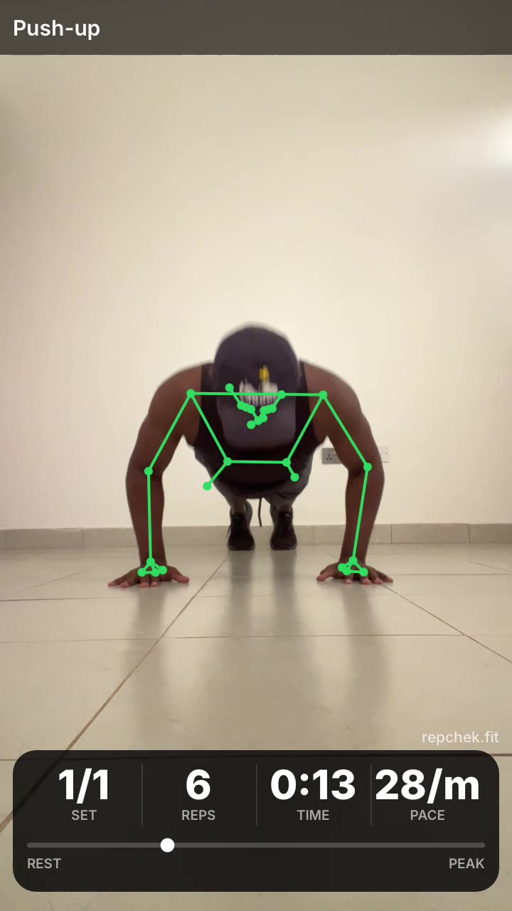
  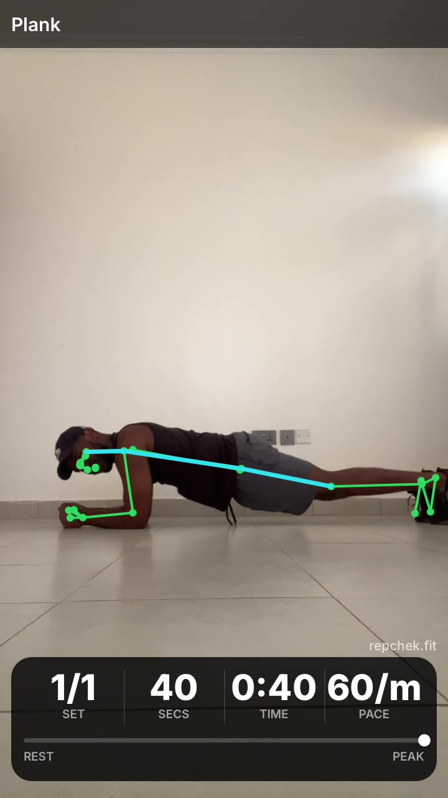
</p>

## Contents

- [What it does](#what-it-does)
- [Screenshots](#screenshots)
- [Using the app](#using-the-app)
- [How the computer vision works](#how-the-computer-vision-works)
- [Run it locally](#run-it-locally)
- [Set up your own backend](#set-up-your-own-backend)
- [Project structure](#project-structure)
- [Add an exercise](#add-an-exercise)
- [Tuning with debug mode](#tuning-with-debug-mode)
- [Privacy](#privacy)
- [Limitations](#limitations)
- [Contributing](#contributing)
- [License](#license)

## What it does

- **Counts reps and seconds live** for 13 exercises, from a single phone
  camera. No wearables, no app to install.
- **Checks form on every rep.** A red banner and a short spoken cue when a rule
  breaks ("Straight body", "Chest up"). Only clean reps count as clean.
- **Records your set** with the live stats bar (Set, Reps, Time, Pace) burned
  into the video, so you can watch it back and share it.
- **Saves every workout** to your account: history, a clean rate chart,
  insights, personal bests, streaks with a weekly goal, an activity heatmap,
  XP and levels.
- **Tells you when to progress.** After three clean sessions it suggests adding
  2 reps or 2.5 kg (Premium).
- **Challenges** with a shareable link and a leaderboard, the Hall of Gains,
  ranked on workouts or clean reps.
- **Guided stretching**: an 8 minute full body routine with pictures, a timer
  and voice, no camera needed.

### Exercises

| At home | Free weights | Holds (counts seconds) |
|---|---|---|
| Push-up (side or front view) | Deadlift | Plank |
| Mike Tyson push-up | Bent-over barbell row | Wall sit |
| Mountain climbers | Dumbbell row | |
| Squat (bodyweight, goblet or barbell) | Biceps curl | |
| Glute bridge | Pull-up | |
| Crunches | | |

Plus a guided **Full body stretch** routine (10 stretches, about 8 minutes).

The newest exercises (crunches, plank, pull-up, dumbbell row, squat, glute
bridge, wall sit, Mike Tyson push-up) use thresholds reasoned from the body and
tested on synthetic frames. They have not yet been tuned on many recorded sets,
so expect some miscounts. See [Tuning with debug mode](#tuning-with-debug-mode).

## Screenshots

The app screens below use sample data. The two photos above are real sets.

| Home | All exercises | Workout setup |
|---|---|---|
| 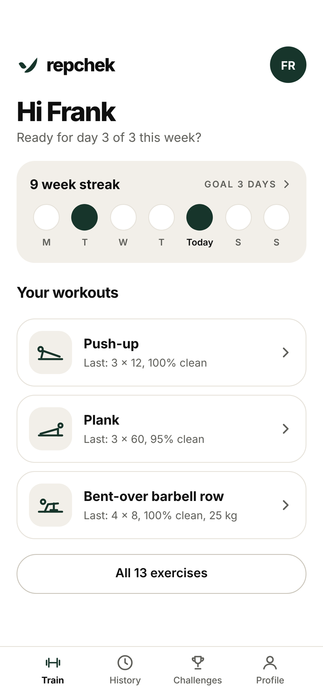 | 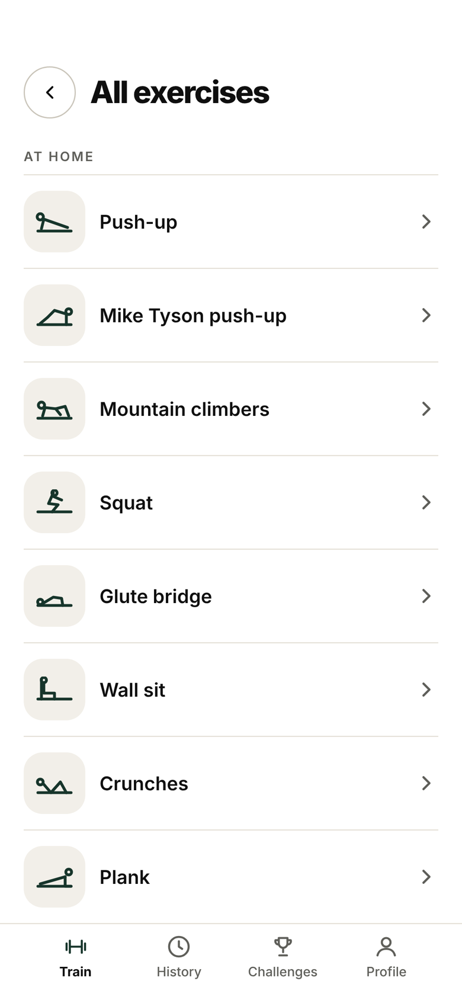 | 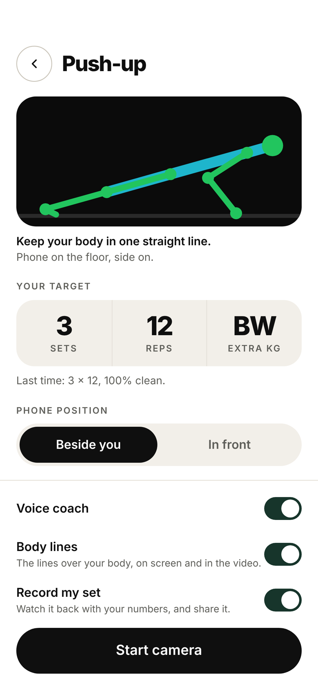 |

| History | Progress | When to progress |
|---|---|---|
| 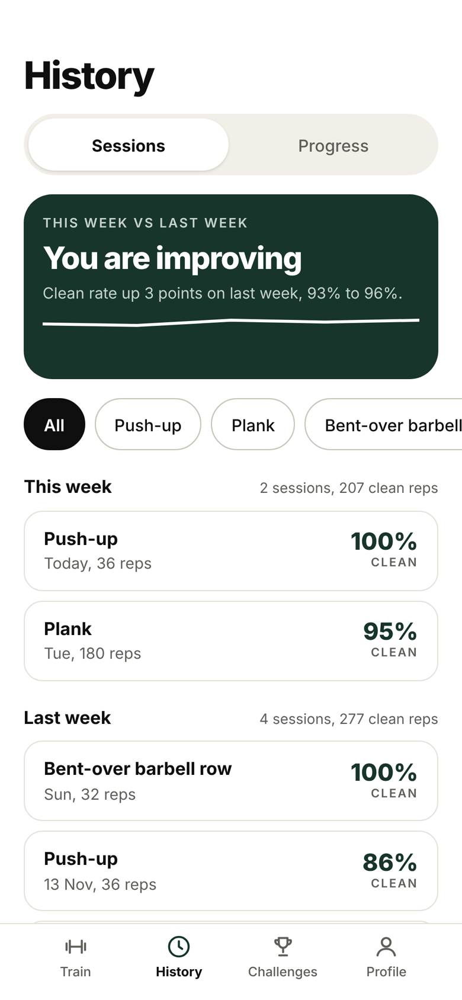 | 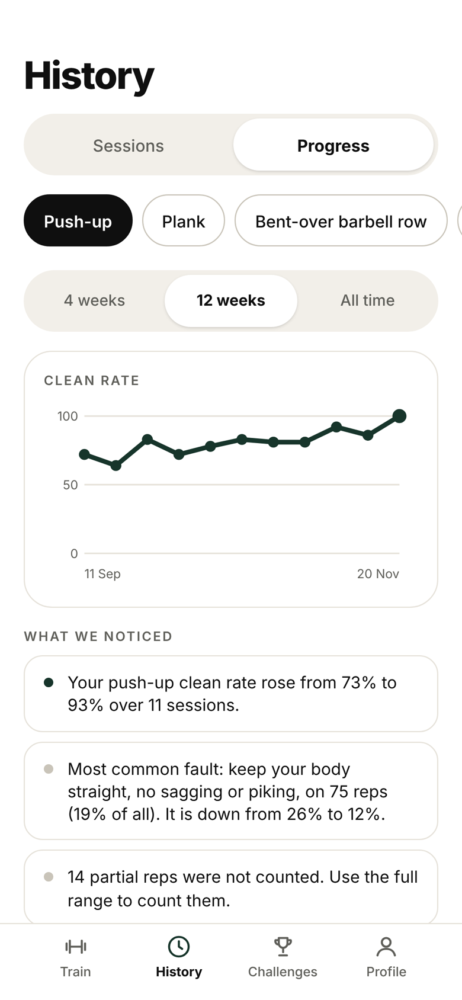 | 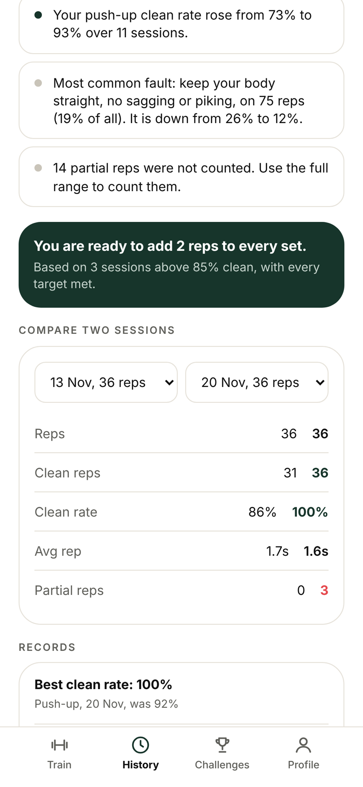 |

| Profile | Streak and heatmap | Challenge |
|---|---|---|
| 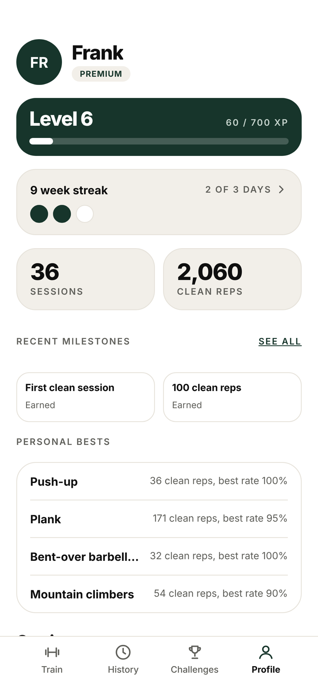 | 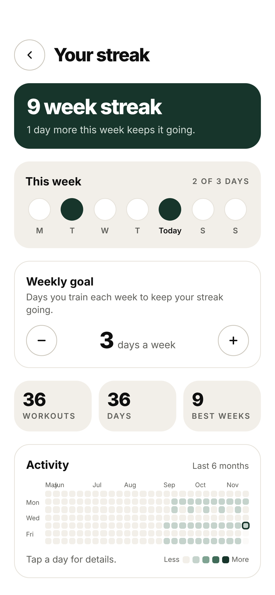 | 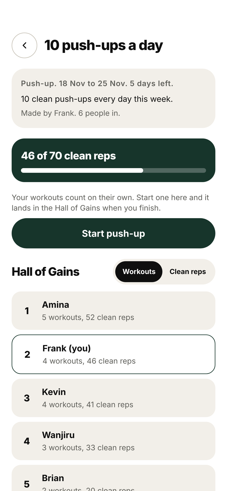 |

| Hall of Gains | Guided stretch | |
|---|---|---|
| 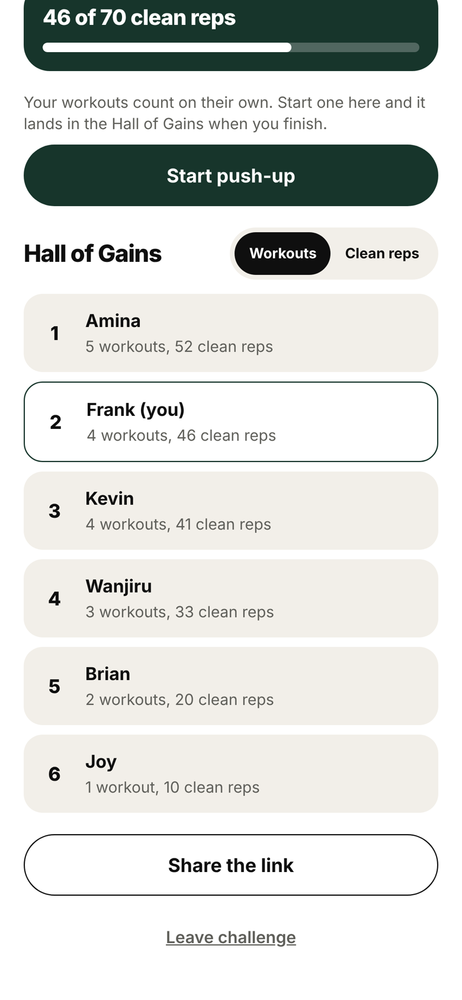 | 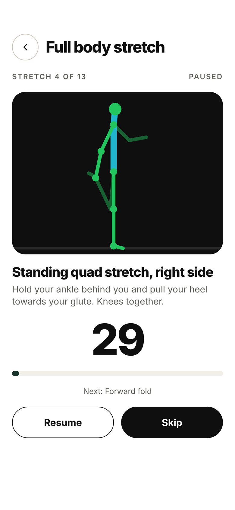 | |

## Using the app

1. **Sign in** at [app.repchek.fit](https://app.repchek.fit) with Google or an
   email code. Your workouts are saved to your account.
2. **Allow the camera** when asked. A short "How it works" screen follows once.
3. **Pick an exercise** on Train, or tap All exercises.
4. **Set up.** Choose your sets and reps (or seconds for a hold), and where the
   phone is (beside you or in front, for exercises that support both). The
   switches at the bottom turn the voice coach, the body lines and the
   recording on or off.
5. **Place the phone.** For most exercises: on the floor or a low surface, side
   on, two to three metres away, with your whole body in frame.
6. **Tap Start camera** and get into the start position. Counting begins once
   you hold still for a second. The pill at the top tells you what it is
   waiting for ("Step into view", "Hold still").
7. **Train.** The stats bar shows Set, Reps, Time and Pace. Tap **Stats** to hide
   it, or **Lines** to hide the skeleton. Rest between sets is detected for you.
8. **Finish** to see the summary: clean reps, every rep with its faults, and
   your recorded sets. Tap **Watch** to replay a set or **Share** to send it.

## How the computer vision works

Everything below runs on the device, in the browser, on every camera frame.
There is no model training: the app uses a pre-trained pose model and turns its
output into geometry and rules.

```
camera frame
  -> pose model          33 body landmarks per person (MediaPipe Pose Landmarker lite)
  -> lifter lock         pick the person who is training when several are in view
  -> confidence check    skip frames where the needed joints are not seen clearly
  -> metrics             joint angles and body-relative measures
  -> readiness gate      start counting only once you hold the start position
  -> rep counter         a state machine on one metric (or a seconds timer for holds)
  -> judge               per-exercise form rules, with a 5 frame streak against noise
  -> session tracker     reps into sets, rest detection, the session record
  -> screen, voice, recording and saving
```

1. **Pose model** (`src/engine/pose.ts`). MediaPipe Tasks Vision runs the
   Pose Landmarker lite model on the GPU when available, falling back to the
   CPU. The model file and the WASM engine are self-hosted in `public/`, so
   there is no runtime CDN. Up to three people are detected per frame.
2. **Lifter lock** (`src/engine/lifter.ts`). In a busy room the camera often
   sees more than one person. Each person gets a track, and the lifter is the
   one in position whose arms move the way the exercise expects. See
   `docs/07-lifter-lock.md`.
3. **Metrics** (`src/engine/angles.ts`). Landmarks are corrected for the frame's
   aspect ratio, then turned into angles with `atan2`: knee, hip and elbow
   angles on the side facing the camera, torso angle from horizontal, neck
   angle, upper arm and forearm tilt, and a few ratios such as how far the
   wrists rise over the torso length. Front view push-ups use a remembered
   reference for the hands and shoulder width, because the model squashes the
   shoulders at the bottom of the rep (`src/engine/reference.ts`).
4. **Readiness gate** (`src/engine/readiness.ts`). Nothing is counted or judged
   until you are seen clearly, in the start zone of the rep, passing the
   exercise's posture checks, and still for one second. Some lifts arm on the
   first full rep instead (a rolling start), since lifters row as soon as they
   pick up the bar.
5. **Rep counter** (`src/engine/repCounter.ts`). Each exercise names one metric
   with a start value and a turn value. The counter moves through
   `ready -> moving-out -> turn -> moving-back` and counts a rep when you come
   back to the start. Zones have a 15 percent margin. A rep that goes at least
   40 percent of the way and comes back is a partial, not a rep. Holds such as
   the plank count one for each second spent in position instead.
6. **Judge** (`src/engine/judge.ts`). A form rule is a metric with a minimum
   and/or maximum, optionally only in one phase of the rep. A rule must fail 5
   frames in a row before it shows, so a single bad frame never flags a rep.
7. **Session** (`src/engine/session.ts`). Reps roll up into sets against your
   target, rest is detected when you stop, and the finished session is a plain
   record: every rep with its duration, faults and time in the set.

**Exercises are data, not code.** Each one is a profile in `src/profiles/`: the
rep metric with its start and turn, the posture checks, the form rules with
messages and spoken cues, and the camera view. The engine never changes per
exercise. Deeper notes live in `docs/`:

| Doc | Topic |
|---|---|
| [`00-architecture.md`](docs/00-architecture.md) | The whole system and the key decisions |
| [`01-camera.md`](docs/01-camera.md) | Getting video from a phone browser |
| [`03-angle-math.md`](docs/03-angle-math.md) | Landmarks to angles |
| [`04-judge-and-profiles.md`](docs/04-judge-and-profiles.md) | Form rules and exercise profiles |
| [`05-rep-counter.md`](docs/05-rep-counter.md) | The rep state machine, sets and rest |
| [`06-recording.md`](docs/06-recording.md) | Recording sets with the overlay |
| [`07-lifter-lock.md`](docs/07-lifter-lock.md) | Picking the lifter out of a crowd |

## Run it locally

You need Node 20.19 or later, or Node 22.12 or later.

```bash
git clone https://github.com/frankndungu/repchek.git
```

```bash
cd repchek
```

```bash
npm install
```

```bash
cp .env.example .env.local
```

```bash
npm run dev
```

Open the local address on a laptop to try it with a webcam. Without Supabase
keys in `.env.local` the app shows a "Sign in is not set up" screen; to get
past it, set up a backend (next section) or point it at your own project.

To test on a phone, the page must be served over HTTPS, because browsers only
give camera access to secure pages. Deploy to Vercel (the repo includes
`vercel.json`) or use a tunnel such as `cloudflared` or `ngrok`.

Other commands:

```bash
npm test
```

```bash
npm run build
```

## Set up your own backend

The app needs a [Supabase](https://supabase.com) project for sign-in and
saving workouts. Payments are optional.

1. **Create a Supabase project.** Under Project Settings, API, copy the project
   URL and the anon (public) key into `.env.local`:
   ```
   VITE_SUPABASE_URL=https://your-project.supabase.co
   VITE_SUPABASE_ANON_KEY=your-anon-key
   ```
   The anon key is meant to be public. Never put the service role key in the
   app or in any `VITE_` variable.
2. **Run the migrations** in `supabase/migrations/` in order, with the Supabase
   CLI (`supabase db push`) or by pasting each file into the SQL editor. They
   create `profiles`, `sessions`, the challenge tables and the database
   functions, all with row level security.
3. **Sign-in.** Under Authentication, enable Email (with the code template) and
   optionally Google. Add your local and deployed addresses to the redirect
   URLs.
4. **Payments (optional).** Premium uses [Polar](https://polar.sh). Deploy the
   edge functions in `supabase/functions/` and set these secrets on the
   Supabase project (never in the app): `POLAR_ACCESS_TOKEN`,
   `POLAR_WEBHOOK_SECRET`, `POLAR_PRODUCT_ID`, `POLAR_ENV` (`sandbox` or
   `production`) and `APP_URL`. Then set `VITE_PREMIUM_CHECKOUT=on` to show
   the Upgrade button. Leave it empty and the app runs without payments.

## Project structure

```
src/
  engine/        the computer vision pipeline: pose, lifter lock, angles,
                 readiness gate, rep counter, judge, session
  profiles/      one file per exercise, plus the registry and exercise list
  ui/            screens: train, setup, live HUD, summary, history, profile,
                 streak, challenges, stretch, recorder, overlay, voice, audio
  storage/       IndexedDB, so a workout survives a reload mid set
  account.ts     profile and saved sessions (Supabase)
  auth.ts        sign-in (Supabase), the only place auth calls live
  billing.ts     Premium checkout and portal
  challenges.ts  challenge logic; challengeApi.ts talks to the database
  analytics.ts   the progress report behind Premium
  progress.ts    XP, levels, streaks, heatmap, milestones
  stretches.ts   guided stretch routines
  diagnostics.ts debug capture for tuning
  main.ts        wires the camera, the pipeline and the screens together
supabase/
  migrations/    database schema, row level security and functions
  functions/     edge functions for Polar checkout and webhooks
tests/           vitest, one file per area
docs/            one concept doc per stage, plus screenshots and mockups
DEVLOG.md        the build log, start to now
```

Plain logic lives in files with no DOM or network, so it is easy to test. The
screens in `src/ui/` call into them.

## Add an exercise

1. **Create a profile** in `src/profiles/`, for example `lunge.ts`:
   ```ts
   import type { ExerciseProfile } from "../engine/types";

   export const lunge: ExerciseProfile = {
     id: "lunge",
     name: "Lunge",
     cameraView: "side",
     bodyweight: true,
     setupHint: "Stand sideways to the phone, whole body in frame",
     requiredJoints: ["shoulder", "hip", "knee", "ankle"],
     // The metric that swings during a rep, where it starts and where it turns.
     rep: { metric: "kneeAngle", start: 160, turn: 95 },
     // Posture checks before counting starts.
     ready: [{ metric: "torsoAngle", min: 60, hint: "Stand tall" }],
     rules: [
       { id: "chest-up", metric: "torsoAngle", min: 60,
         message: "Keep your chest up", cue: "Chest up" },
     ],
   };
   ```
   For a hold, add `hold: true` and describe the position in `ready`: one
   second in position counts as one.
2. **Register it** in `src/profiles/index.ts`: add it to `PROFILES`, and add an
   entry to `EXERCISES` with its section and phone position.
3. **Add the setup content**: a one-line tip in `src/formCues.ts`, an icon in
   `src/ui/train.ts`, and a form picture in `src/ui/formPreviews.ts`.
4. **Test it** in `tests/` with made-up frames: a full rep counts, a short one
   is a partial, the wrong posture does not arm, and each rule fires.
5. **Tune it** on real sets with debug mode, below.
6. **Challenges** only count exercises on the list in the `create_challenge`
   database function, so add the new profile id there in a migration.

## Tuning with debug mode

Open the app once with `?debug=1` (for example `http://localhost:5173/?debug=1`).
After a set, More options on Workout setup has a Debug data row:

- **Numbers**: a JSON file with every frame the engine saw (the metrics, the
  gate state, the phase, rep events and faults), enough to replay the counting
  offline.
- **Video**: the raw camera video with nothing drawn on it.

Nothing is sent anywhere; you choose to share the files. Open `?debug=0` to
turn it off. Thresholds in profiles that came from recorded sets are commented
as such; the rest say "provisional".

## Privacy

Pose detection runs on the device. The camera video is analysed in the browser
and is not uploaded. Recorded clips stay on the device until you choose to share
them. What is saved to the account is the workout record: the exercise, the
target, the reps with their faults, and the date. See the
[privacy policy](https://repchek.fit/privacy).

## Limitations

- **One camera, 2D.** Each exercise is judged from one view. Some faults need a
  view the camera does not have, like elbow flare from the side.
- **Thresholds are fixed per exercise**, not calibrated to your body yet.
- **Lighting and clothing matter.** Loose clothes and dark rooms lower the
  model's confidence, and frames below it are skipped.
- **Machines and benches** hide parts of the body, so the app focuses on home
  workouts and free weights. Profiles for some gym lifts (bench press, lat
  pulldown, triceps) are still in `src/profiles/` but not offered.

## Contributing

Issues and pull requests are welcome, especially recorded sets that miscount,
new exercise profiles and better thresholds. See
[CONTRIBUTING.md](CONTRIBUTING.md).

## License

[MIT](LICENSE). Copyright (c) 2026 Francis Ndungu.

The pose model is Google's MediaPipe Pose Landmarker, used under the
[Apache 2.0 license](https://github.com/google-ai-edge/mediapipe/blob/master/LICENSE).
